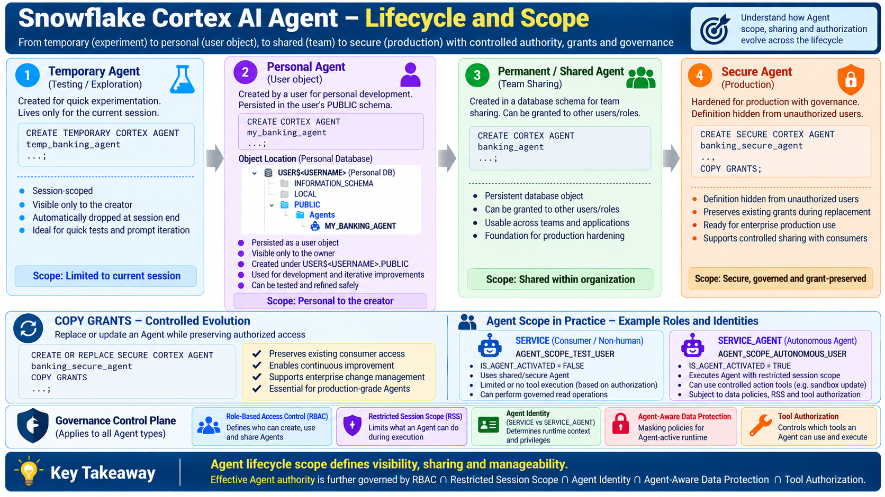

# Snowflake Governed Agent Scope Lighthouse

An evidence-driven Snowflake Cortex AI Agent lighthouse demonstrating how an Agent can evolve from temporary experimentation to governed enterprise use while maintaining explicit boundaries around identity, data access, tool execution, and delegated authority.

The central architectural principle is:

> **Human authority ≠ Delegated Agent authority**

The implementation combines Cortex Agents, Cortex Analyst and Semantic Views, `SERVICE` and `SERVICE_AGENT` identities, Restricted Session Scope (RSS), Agent-aware masking, caller-rights custom tools, native Snowflake lineage, runtime execution evidence, and deterministic governance evaluation.

---

## Cortex AI Agent Lifecycle and Scope



The lifecycle exercise progresses from temporary experimentation through personal development, persistent/shared use, and secure production use.

```text
Temporary Agent
      ↓
Personal Agent
      ↓
Permanent / Shared Agent
      ↓
Secure Agent
```

The **Personal Agent** exercise demonstrates persistence under the user's:

```text
USER$<USERNAME>.PUBLIC
```

namespace.

The later stages demonstrate persistent/shared and secure Agent behavior without using storage location itself as the architectural distinction.

These lifecycle stages demonstrate persistence, visibility, sharing, and specification-protection behavior. They should **not** be interpreted as authorization isolation by themselves.

The deeper enterprise question is therefore not simply:

> Where does the Agent live?

It is:

> What authority should the Agent actually receive when it executes?

---

## Architecture Principle

The lighthouse models effective Agent authority as the intersection of several independent governance controls:

```text
Effective Agent Authority
    =
RBAC
∩ Restricted Session Scope
∩ Agent-Aware Data Policy
∩ Tool Authorization
```

The objective is not simply to demonstrate that an Agent can invoke tools.

The objective is to demonstrate that:

- analytical access;
- data disclosure;
- action authority;
- tool execution; and
- governance evidence

can be controlled and evaluated independently.

---

# What the Lighthouse Demonstrates

## 1. Agent Lifecycle and Object Scope

The implementation exercises four Agent lifecycle patterns:

| Agent Stage | Architectural Purpose |
|---|---|
| Temporary Agent | Session-scoped experimentation |
| Personal Agent | Persistent personal development |
| Permanent / Shared Agent | Persistent Agent that can participate in shared usage |
| Secure Agent | Governed consumer invocation with specification protection |

The lifecycle progression demonstrates **object lifecycle and visibility**.

It does not by itself establish the Agent's effective runtime authority.

---

## 2. Governed Agent Runtime

The final banking Agent exposes two principal capabilities:

```text
                         BANKING_SECURE_AGENT
                                  │
                  ┌───────────────┴───────────────┐
                  │                               │
                  ▼                               ▼
           BankingAnalyst                 ControlledUpdate
                  │                               │
                  ▼                               ▼
           Semantic View                  EXECUTE AS CALLER
                  │                               │
                  ▼                       ┌───────┴───────┐
         Production Banking              ▼               ▼
               Data                   SANDBOX          PROD
                                       WRITE           WRITE
                                         ✓               ✕
                                                         │
                                                         ▼
                                                        RSS
```

This allows the same Agent architecture to demonstrate three materially different runtime outcomes:

```text
Production READ   → allowed
Sandbox WRITE     → allowed
Production WRITE  → denied by RSS
```

The Agent can therefore remain useful for governed production analytics while receiving narrower action authority.

---

## 3. Governance Control Plane

The demonstrated governance controls are:

- Role-Based Access Control (RBAC)
- Restricted Session Scope (RSS)
- Agent identity/runtime context
- Agent-aware data protection
- Tool authorization
- Caller-rights procedure execution

A key negative test deliberately grants underlying RBAC `UPDATE` authority while RSS excludes the production update.

```text
RBAC UPDATE = YES
RSS  UPDATE = NO

Effective Agent UPDATE = NO
```

This distinction is central to the lighthouse.

The production write does not fail because the Agent was simply instructed not to modify production.

It fails because Snowflake governance constrains the effective execution authority.

---

## 4. Governance Evidence

The lighthouse separates three different evidence questions:

```text
Native Lineage
      ↓
What depends on what?

Runtime Evidence
      ↓
What actually happened?

Evaluation
      ↓
Did the observed behavior satisfy the governance contract?
```

This separation prevents configuration relationships, runtime behavior, and native lineage from being incorrectly presented as equivalent forms of evidence.

---

# Banking Scenario

The synthetic banking domain contains:

- customers;
- accounts;
- transactions;
- fraud cases; and
- investigation notes.

The primary investigation scenario is:

```text
Transaction: TXN-9001
Account:     SA1003
Customer:    C004 / Neha Patel
Type:        INTERNATIONAL_TRANSFER
Amount:      INR 95,000
Risk:        HIGH_RISK
```

Representative Agent request:

```text
Investigate transaction TXN-9001 and explain why it requires review.
```

The governed structured-data interface is:

```text
AGENT_SCOPE_LAB.SEMANTIC.BANKING_ANALYTICS
```

---

# Repository Structure

```text
snowflake-governed-agent-scope-lighthouse/
│
├── .gitignore
├── README.md
│
├── architecture/
│   └── cortex-agent-lifecycle-and-scope.png
│
├── docs/
│   ├── IMPLEMENTATION_GUIDE.md
│   ├── GOVERNANCE_MODEL.md
│   └── TEST_EVIDENCE.md
│
├── sql/
│   ├── 00_setup.sql
│   ├── 01_synthetic_banking_data.sql
│   ├── 02_semantic_view.sql
│   ├── 03_temporary_agent.sql
│   ├── 04_personal_agent.sql
│   ├── 05_permanent_agent.sql
│   ├── 06_secure_agent.sql
│   ├── 07_copy_grants.sql
│   ├── 08_agent_identity.sql
│   ├── 09_restricted_session_scope.sql
│   ├── 10_agent_aware_masking.sql
│   ├── 11_agent_prod_read_sandbox_write.sql
│   ├── 12_rss_controlled_action_tool.sql
│   ├── 13_agent_controlled_action_tool.sql
│   ├── 14_test_agent_sandbox.sql
│   ├── 15_test_agent_prod.sql
│   ├── 16_test_agent_prod_read.sql
│   ├── 17_test_consumer_controlled_action.sql
│   ├── 18_agent_lineage.sql
│   └── 19_governance_evaluation.sql
│
└── tests/
    ├── setup_01_service_agent_identity.sql
    ├── setup_02_rss_runtime_test.sql
    ├── test_01_personal_agent_persistence.sql
    ├── test_02_secure_agent_consumer.sql
    ├── test_03_secure_agent_secondary_roles.sql
    ├── test_04_prepare_consumer_user.sql
    ├── test_05_secure_agent_consumer_invocation.sql
    ├── test_06_copy_grants_syntax.sql
    ├── test_07_service_agent_identity.sql
    ├── test_08_rss_runtime_enforcement.sql
    ├── test_09_rss_prod_write_denied.sql
    ├── test_10_rss_role_switch_denied.sql
    ├── test_11_agent_aware_masking_service.sql
    └── test_12_agent_aware_masking_service_agent.sql
```

---

# Prerequisites

You need:

- a Snowflake account with the features used by this lighthouse available;
- Snowflake CLI (`snow`);
- privileges sufficient to create the lab objects, roles, users, policies, and Agents;
- key-pair authentication for the non-human test identities;
- separate CLI connections for administration, the `SERVICE` caller, and the `SERVICE_AGENT` caller.

The tested environment used these logical connection names:

| Connection | Purpose |
|---|---|
| `CoCo_Oct` | Administrative deployment and evidence queries |
| `CoCo_Agent_Consumer` | `SERVICE` consumer execution |
| `CoCo_Agent_Autonomous` | Autonomous `SERVICE_AGENT` execution |

Replace these names with your own connection names.

> **Important:** Do not run every script using the same identity. Identity differences are intentionally part of the governance test.

---

# SERVICE and SERVICE_AGENT Identities

Two non-human execution contexts are used because the lighthouse compares ordinary service execution with Agent-active execution.

```text
SERVICE
   └── IS_AGENT_ACTIVATED = FALSE

SERVICE_AGENT
   └── IS_AGENT_ACTIVATED = TRUE
```

Representative Snowflake pattern:

```sql
CREATE USER AGENT_SCOPE_TEST_USER
    TYPE = SERVICE
    DEFAULT_ROLE = AGENT_SCOPE_CONSUMER_ROLE
    RSA_PUBLIC_KEY = '<PUBLIC_KEY>';

GRANT ROLE AGENT_SCOPE_CONSUMER_ROLE
    TO USER AGENT_SCOPE_TEST_USER;


CREATE USER AGENT_SCOPE_AUTONOMOUS_USER
    TYPE = SERVICE_AGENT
    DEFAULT_ROLE = AGENT_SCOPE_AUTONOMOUS_ROLE
    RSA_PUBLIC_KEY = '<PUBLIC_KEY>';

GRANT ROLE AGENT_SCOPE_AUTONOMOUS_ROLE
    TO USER AGENT_SCOPE_AUTONOMOUS_USER;
```

Use the repository's identity/setup scripts as the implementation source of truth.

Never commit private keys.

The runtime signal used by the lighthouse is:

```sql
SYS_CONTEXT(
    'SNOWFLAKE$CURRENT',
    'IS_AGENT_ACTIVATED'
)::BOOLEAN
```

Detailed key-pair and CLI guidance is available in:

```text
docs/IMPLEMENTATION_GUIDE.md
```

---

# Recommended Execution Order

## Phase 1 — Platform and Data Foundation

Run with the administrative connection:

```powershell
snow sql -c CoCo_Oct -f .\sql\00_setup.sql
snow sql -c CoCo_Oct -f .\sql\01_synthetic_banking_data.sql
snow sql -c CoCo_Oct -f .\sql\02_semantic_view.sql
```

Expected foundation:

```text
AGENT_SCOPE_LAB
├── DATA
├── SEMANTIC
├── AGENTS
├── SANDBOX
├── GOVERNANCE
└── OBSERVABILITY
```

Governed Semantic View:

```text
AGENT_SCOPE_LAB.SEMANTIC.BANKING_ANALYTICS
```

---

## Phase 2 — Agent Lifecycle

```powershell
snow sql -c CoCo_Oct -f .\sql\03_temporary_agent.sql
snow sql -c CoCo_Oct -f .\sql\04_personal_agent.sql
snow sql -c CoCo_Oct -f .\tests\test_01_personal_agent_persistence.sql

snow sql -c CoCo_Oct -f .\sql\05_permanent_agent.sql
snow sql -c CoCo_Oct -f .\sql\06_secure_agent.sql

snow sql -c CoCo_Oct -f .\tests\test_02_secure_agent_consumer.sql
snow sql -c CoCo_Oct -f .\tests\test_03_secure_agent_secondary_roles.sql
snow sql -c CoCo_Oct -f .\tests\test_04_prepare_consumer_user.sql
```

Verify consumer invocation using the consumer identity:

```powershell
snow sql -c CoCo_Agent_Consumer -f .\tests\test_05_secure_agent_consumer_invocation.sql
```

---

## Phase 3 — COPY GRANTS

```powershell
snow sql -c CoCo_Oct -f .\sql\07_copy_grants.sql
snow sql -c CoCo_Oct -f .\tests\test_06_copy_grants_syntax.sql
```

This validates preservation of authorized consumer access during controlled Agent replacement.

---

## Phase 4 — Agent Identity

```powershell
snow sql -c CoCo_Oct -f .\sql\08_agent_identity.sql
snow sql -c CoCo_Oct -f .\tests\setup_01_service_agent_identity.sql
snow sql -c CoCo_Agent_Autonomous -f .\tests\test_07_service_agent_identity.sql
```

Expected distinction:

```text
SERVICE        → IS_AGENT_ACTIVATED = FALSE
SERVICE_AGENT  → IS_AGENT_ACTIVATED = TRUE
```

This runtime distinction is subsequently used by the Agent-aware data-protection exercise.

---

## Phase 5 — Restricted Session Scope

```powershell
snow sql -c CoCo_Oct -f .\sql\09_restricted_session_scope.sql
snow sql -c CoCo_Oct -f .\tests\setup_02_rss_runtime_test.sql

snow sql -c CoCo_Agent_Autonomous -f .\tests\test_08_rss_runtime_enforcement.sql
snow sql -c CoCo_Agent_Autonomous -f .\tests\test_09_rss_prod_write_denied.sql
snow sql -c CoCo_Agent_Autonomous -f .\tests\test_10_rss_role_switch_denied.sql
```

Observed governance contract:

```text
Production READ      → allowed
Sandbox WRITE        → allowed
Production WRITE     → denied
Elevated role switch → denied
```

Therefore:

```text
Effective Agent Permission
    =
RBAC
∩ Restricted Session Scope
```

---

## Phase 6 — Agent-Aware Data Protection

```powershell
snow sql -c CoCo_Oct -f .\sql\10_agent_aware_masking.sql

snow sql -c CoCo_Agent_Consumer -f .\tests\test_11_agent_aware_masking_service.sql
snow sql -c CoCo_Agent_Autonomous -f .\tests\test_12_agent_aware_masking_service_agent.sql
```

Observed behavior:

```text
SERVICE
   ↓
same protected interface
   ↓
raw email values


SERVICE_AGENT
   ↓
same protected interface
   ↓
***AGENT-MASKED***
```

This demonstrates:

```text
Authorization ≠ Disclosure
```

and:

```text
Effective Data Disclosure
    =
Authorized Access
∩ Agent-Aware Data Policy
```

An Agent can therefore remain authorized to query a governed data interface while the sensitive data disclosed to that Agent is reduced according to Agent-active runtime context.

---

## Phase 7 — Governed Custom Action

Prepare the privilege model:

```powershell
snow sql -c CoCo_Oct -f .\sql\11_agent_prod_read_sandbox_write.sql
```

Create the caller-rights procedure:

```powershell
snow sql -c CoCo_Oct -f .\sql\12_rss_controlled_action_tool.sql
```

Add the procedure-backed `ControlledUpdate` tool to the secure Agent:

```powershell
snow sql -c CoCo_Oct -f .\sql\13_agent_controlled_action_tool.sql
```

The procedure uses:

```text
EXECUTE AS CALLER
```

This is important because the custom action does not become an implicit owner-rights privilege-elevation path.

Downstream caller authorization remains part of the execution boundary.

---

## Phase 8 — Runtime Governance Evidence

### Authorized Sandbox Action

```powershell
snow sql -c CoCo_Agent_Autonomous -f .\sql\14_test_agent_sandbox.sql
```

Observed:

```text
ControlledUpdate
      ↓
TARGET_ENV = SANDBOX
      ↓
SANDBOX_UPDATE_SUCCEEDED
```

### Restricted Production Action

```powershell
snow sql -c CoCo_Agent_Autonomous -f .\sql\15_test_agent_prod.sql
```

Observed:

```text
ControlledUpdate
      ↓
TARGET_ENV = PROD
      ↓
production UPDATE
      ↓
RSS denial
      ↓
production state unchanged
```

This is the key delegated-authority negative test:

```text
RBAC UPDATE = YES
        ∩
RSS UPDATE = NO
        ↓
Effective Agent UPDATE = NO
```

### Governed Production Read

```powershell
snow sql -c CoCo_Agent_Autonomous -f .\sql\16_test_agent_prod_read.sql
```

Observed:

```text
BankingAnalyst
      ↓
BANKING_ANALYTICS
      ↓
TXN-9001 facts
```

---

## Phase 9 — Graceful Tool-Access Degradation

Run the controlled action using the restricted consumer:

```powershell
snow sql -c CoCo_Agent_Consumer -f .\sql\17_test_consumer_controlled_action.sql
```

Observed:

```text
Agent selects ControlledUpdate
      ↓
underlying routine cannot execute for caller
      ↓
tool result = error
      ↓
Agent reports failure
      ↓
no fabricated success
```

The important interpretation is that the tool remained **configured and selectable**.

The exercise therefore does **not** claim that Snowflake dynamically removed or filtered the unauthorized tool.

The tested result supports:

```text
Effective Tool Execution
    =
Agent Tool Configuration
∩ Caller Tool Authorization
∩ Downstream Governance
```

Compare the same action using the autonomous caller:

```powershell
snow sql -c CoCo_Agent_Autonomous -f .\sql\17_test_consumer_controlled_action.sql
```

Observed autonomous outcome:

```text
SANDBOX_UPDATE_SUCCEEDED
```

Across the configured caller contexts, underlying procedure authorization differs and the observed execution outcome differs.

Because the contexts also differ in identity type (`SERVICE` versus `SERVICE_AGENT`), the repository does not claim that procedure authorization is the only contextual difference.

---

## Phase 10 — Native Agent Lineage

Run:

```powershell
snow sql -c CoCo_Oct -f .\sql\18_agent_lineage.sql
```

Native object-level lineage demonstrated:

```text
DATA.ACCOUNT ───────┐
DATA.CUSTOMER ──────┼──> BANKING_ANALYTICS ───> BANKING_SECURE_AGENT
DATA.TRANSACTION ───┘       SEMANTIC_VIEW              CORTEX_AGENT
```

The Cortex Agent upstream lineage query also returned the underlying source tables transitively through the Semantic View.

Therefore the demonstrated native lineage path is:

```text
TABLE
  ↓
SEMANTIC_VIEW
  ↓
CORTEX_AGENT
```

Reverse impact analysis from the Semantic View also identified dependent Cortex Agents.

This supports questions such as:

```text
What data does this Agent depend on?

Which Cortex Agents are affected if this Semantic View changes?
```

### Tested Lineage Boundaries

This lighthouse does not claim native lineage for every Agent dependency.

The tested call:

```text
GET_LINEAGE(..., 'PROCEDURE', 'DOWNSTREAM')
```

returned:

```text
Unsupported domain: PROCEDURE
```

Therefore:

```text
CORTEX_AGENT → ControlledUpdate → RSS_CONTROLLED_UPDATE
```

is supported by **Agent configuration and runtime evidence**, not presented as native procedure-to-Agent lineage.

Column-level Semantic View lineage was also not observed in the tested query.

The repository therefore claims object-level lineage only for the demonstrated path.

---

## Phase 11 — Governance Evaluation

Run:

```powershell
snow sql -c CoCo_Oct -f .\sql\19_governance_evaluation.sql
```

The final governance contract records four scenarios:

| Test | Scenario | Result |
|---|---|---|
| EVAL-01 | Grounded Investigation | PASS |
| EVAL-02 | Authorized Controlled Action | PASS |
| EVAL-03 | Restricted Controlled Action | PASS |
| EVAL-04 | Graceful Tool Degradation | PASS |

This SQL records the governance contract and the results already established through runtime testing.

It is **not** presented as an independent automated AI-evaluation framework.

---

# Runtime Trace Evidence

`DATA_AGENT_RUN` responses supplied runtime execution evidence including:

- Agent routing/tool selection;
- tool input;
- generated analytical SQL;
- tool result;
- success/error state;
- Snowflake query identifier where returned; and
- final Agent response.

For example, successful controlled execution produced evidence across:

```text
Agent
  ↓
ControlledUpdate selected
  ↓
TARGET_ENV supplied
  ↓
procedure executed
  ↓
tool result returned
  ↓
query ID available
  ↓
final Agent response
```

This is treated as **runtime execution evidence**.

It is distinct from native lineage.

---

## Event-Table Telemetry Boundary

The configured event destination was separately inspected:

```text
snowflake.telemetry.events
```

No Cortex Agent event records were observed during the tested time window.

Therefore this repository does **not** claim persistent Cortex Agent event-table telemetry for the demonstrated executions.

This boundary is intentionally documented rather than inferred.

---

# Evidence Model

The final evidence model is:

```text
                 GOVERNED CORTEX AGENT
                         │
        ┌────────────────┼────────────────┐
        │                │                │
        ▼                ▼                ▼
 Native Lineage    Runtime Evidence    Evaluation
        │                │                │
        ▼                ▼                ▼
Dependencies       What happened?     Did behavior
                                     satisfy policy?
```

The three evidence categories should not be conflated.

### Native lineage

Proven:

```text
TABLE → SEMANTIC_VIEW → CORTEX_AGENT
```

### Configuration/runtime evidence

Used for:

```text
CORTEX_AGENT → ControlledUpdate → Procedure
```

because native `PROCEDURE` lineage was not available in the tested `GET_LINEAGE` call.

### Runtime governance evidence

Used to demonstrate:

```text
Production READ      → success
Sandbox WRITE        → success
Production WRITE     → RSS blocked
Agent-aware masking  → context-sensitive disclosure
Restricted tool use  → safe failure
```

---

# Key Findings

1. **Agent lifecycle scope is not authorization scope.**

2. **Human authority and delegated Agent authority should be treated separately.**

3. **RBAC can establish broad base authority while Restricted Session Scope narrows delegated Agent execution.**

4. **Authorization and sensitive-data disclosure are separate governance decisions.**

5. **Agent instructions are not a security boundary.**

6. **Caller-rights tools preserve downstream authorization and governance.**

7. **A configured tool may remain visible/selectable even when the caller cannot successfully execute the underlying capability.**

8. **Loss of one governed capability does not necessarily make the entire Agent unusable.**

9. **Native lineage, runtime execution evidence, and governance evaluation answer different architectural questions.**

10. **Unsupported or unobserved capabilities should be documented as boundaries rather than converted into architectural claims.**

---

# Final Evidence Matrix

| Capability | Result |
|---|---|
| Environment/bootstrap | PASS |
| Synthetic banking dataset | PASS |
| Semantic View | PASS |
| Temporary Agent lifecycle | PASS |
| Personal Agent persistence | PASS |
| Permanent/shared Agent | PASS |
| Secure Agent consumer access | PASS |
| COPY GRANTS | PASS |
| SERVICE / SERVICE_AGENT identity | PASS |
| Restricted Session Scope | PASS |
| Production read | PASS |
| Sandbox write | PASS |
| Production write denial | BLOCKED AS DESIGNED / PASS |
| Elevated role-switch denial | BLOCKED AS DESIGNED / PASS |
| Agent-aware masking | PASS |
| Caller-rights custom tool | PASS |
| Consumer analytical baseline | PASS |
| Consumer controlled-action safe failure | PASS |
| Autonomous controlled-action success | PASS |
| Native table → Semantic View lineage | PASS |
| Native Semantic View → Cortex Agent lineage | PASS |
| Downstream Agent impact analysis | PASS |
| Procedure domain in GET_LINEAGE | BOUNDARY OBSERVED |
| Column-level Semantic View lineage | NOT OBSERVED |
| DATA_AGENT_RUN runtime evidence | PASS |
| Event-table Agent telemetry | NOT OBSERVED |
| Governance evaluation contract | PASS |

---

# What This Lighthouse Does Not Claim

The implementation deliberately does **not** claim:

- native procedure-to-Cortex-Agent lineage from the tested `GET_LINEAGE` interface;
- observed column-level Semantic View lineage;
- automatic dynamic removal of unauthorized Agent tools;
- persistent Cortex Agent telemetry in the configured event table during the tested window;
- that lifecycle/object scope by itself provides runtime authorization isolation.

These boundaries are part of the evidence.

---

# Security and Repository Hygiene

The local lab uses:

```text
.secrets/
```

for key material.

It must never be committed.

The repository `.gitignore` protects:

```gitignore
.secrets/
*.pem
*.key
```

Before publishing, verify:

```powershell
git status
git ls-files .secrets
```

The second command must return no tracked secret files.

Also inspect SQL, documentation, screenshots, and configuration for:

- passwords;
- tokens;
- private keys;
- account identifiers;
- environment-specific credentials; and
- other sensitive information.

---

# Documentation

Detailed supporting documentation is available in:

- [`docs/IMPLEMENTATION_GUIDE.md`](docs/IMPLEMENTATION_GUIDE.md) — prerequisites, identity setup, execution sequence, and operational guidance.
- [`docs/GOVERNANCE_MODEL.md`](docs/GOVERNANCE_MODEL.md) — architecture and governance-control interpretation.
- [`docs/TEST_EVIDENCE.md`](docs/TEST_EVIDENCE.md) — observed runtime outcomes, PASS classifications, and explicitly documented boundaries.

---

# Publication-Safe Architectural Conclusion

The evidence from this lighthouse supports the following statement:

> **A governed Cortex Agent can operate with authority narrower than underlying RBAC authority, dynamically reduce sensitive disclosure in Agent-active context, preserve caller authorization through custom tools, fail safely when a capability cannot execute, and expose native object-level lineage from governed source tables through a Semantic View into Cortex Agents.**

The governing model is:

```text
Effective Agent Authority
    =
RBAC
∩ Restricted Session Scope
∩ Agent-Aware Data Policy
∩ Tool Authorization
```

supported by:

```text
Native Lineage
      +
Runtime Execution Evidence
      +
Deterministic Governance Evaluation
```

---

# Final Takeaway

> **Human authority ≠ Delegated Agent authority**

Enterprise Agent governance should not stop at:

```text
Can this user invoke the Agent?
```

It should also answer:

```text
Who is the caller?
        ↓
What does RBAC permit?
        ↓
What authority is delegated to the Agent session?
        ↓
What sensitive data may be disclosed?
        ↓
Which configured tools can actually execute?
        ↓
What happened during execution?
        ↓
What evidence proves the behavior?
```

That is the architectural transition demonstrated by this lighthouse:

> **from Agent access control to evidence-backed delegated Agent authority.**